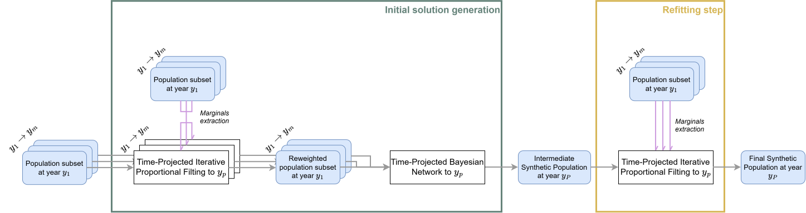
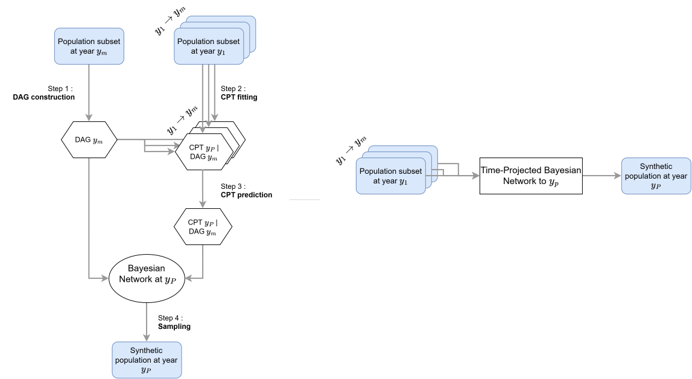
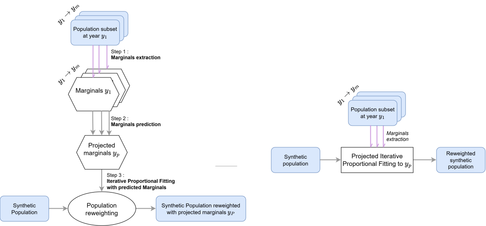

# Time-Projected Bayesian Network and Time-Projected Itertaive Proportional Fitting for predictive Population Synthesis

This Git deposit contains an open-source data-driven framework for generating a future synthetic population. The methodology is designed for short-term projections.
This repo aims for reproductible research. Preprocessed multi-year data from Île-de-France (region around Paris) is available for model testing and comparison with other approaches.


## Objective

This repository contains the code for generating realistic synthetic populations for Activity-Based transportation models across future simulation horizons without requiring target-year data or external expert rules.

To mitigate the temporal degradation of static synthetic populations, the framework combines:

- Time-Projected Bayesian Network (TPBN): Captures dynamic cross-attribute correlations over time by leveraging a fixed structural Directed Acyclic Graph (DAG) with time-projected Conditional Probability Tables.

- Time-Projected Iterative Proportional Fitting (TPIPF): Projects and aligns target marginal distributions across future time steps.

The codebase includes evaluation pipelines run on multi-year French Census data (Île-de-France region) across projection horizons of 1 to 5 years.

## Main reference

This Git deposit is originally the source code from:
> Darsel, V., Come, E., \& Oukhellou, L. (2026) [Learning evolving populations from multi-year data: A self-contained data-driven model for short-term synthetic population forecasting.](https://www.google.com/), Pre-Print available on demand.

## Model description

The model contains two steps: generation of the initial solution and a reffiting step. For the former, training data years are reffitted with an Time-Projected Iterative Proportional Fitting. Then, preprocessed data is used to train a Time-Projected Bayesian Network (TPBN). Thanks to the marginal reffitting, the TPBN only investigates the evolution of the joint distributions. The reffiting step realigns the marginals on the target year. A full picture of the model is given below.



## Modules

Here are a scheme for each module. The full description is available in the paper.

### Time-Projected Bayesian Network (TPBN)


### Time-Projected Iterative Proportional Fitting (TPIPF) 


## Tutorial

### Code pulling

Clone the Git repository on your working place with:

```bash
git clone https://github.com/vdarsel/Synthetic-Population-Forecasting.git 
```

### Data preparation

Preprocessed data from the French Census data from 2007 to 2021 is available [here](https://data.mendeley.com/drafts/dn6ng69xvr). Download either the file ``datasets_Individual_0_03.zip`` or the file ``datasets_Individual_1.zip``. In the former, the training dataset contains 0.03% of the total population, and 1% in the second. Move the dowloaded files to the data folder (Data) and unzip the zip file. In each folder (Data>French_Census_Data_20XX), you should have two files: ``training_dataset_Individual_0_03.csv`` and ``training_dataset_Individual_1.csv``

If you want to use your own dataset, more explanations on the format are given in the [Data Description](https://github.com/vdarsel/PopulationSynthesis/tree/main/data).

### Install required libraries

Create an adequate environment
```bash
conda create --name PopForecast python=3.12.3
```


Install the libraries in the environment with:
```bash
conda activate PopForecast
pip install -r requirements.txt
```

### Run the experiments

The following command launches the experiments (training + sampling + evaluation).

```bash
python full_process.py --n_variables NUMBER --size_data SIZE (--MODELS_PARAMETERS)
```

|Argument           |Description                                                          |Possible Values      |
|-------------------|---------------------------------------------------------------------|---------------------|
|```--n_variables NAME```    |Defines the set of attributes for the experiment.                    |```5```, ```9```, or ```13```                |
|```--size_data SIZE ```  |Specifies the dataset size.                                          |```0_03``` or ```1```                 |
|```--time_horizon NUMBER```    |Number of years between the last training_year and the target year. | Any number |
|```--year_prediction NUMBER```    |Target year. | Any number |

The ```NAME``` argument corresponds to three sets of attributes:
For more details, refer to the [Data scenarios](https://github.com/vdarsel/PopulationSynthesis/tree/main/data?tab=readme-ov-file#data-scenarios) documentation.

#### Initial solution generation

The different options for the initial solution generation:

|Argument           |Description                                                          |
|-------------------|---------------------------------------------------------------------|
|```--TPIPF_pre```    |Preprocess the data through a TPIPF stage.                    |
|```--TPBN```    |Learn and sample a population from a TPBN n multi-year data.|
|```--static_BN```    |Learn and sample a population from a BN, trained on the last year of data.|

#### Refitting stage

The different options for the reffiting stage:

|Argument           |Description                                                          |
|-------------------|---------------------------------------------------------------------|
|```--TPIPF_post```    |Postprocess the data through a TPIPF stage.                    |
|```--Resampling_marginal```    |Apply resampling on the **true** marginal distribution of Age, Sex and Location, for the target year.|
|```--Resampling_joint```    |Apply resampling on the **true** joint distribution of Age, Sex and Location, for the target year.|

#### Regression arguments

The different options for the reffiting stage:

|Argument           |Description                                                          |Possible Values      | Default value
|-------------------|---------------------------------------------------------------------|---------------------|---------------------|
|```--n_years NUMBER```    |Number of years consider in the regression training.                    |Any number | 5 |
|```--alpha_min FLOAT```    |Minimum value for the discount factor. | Any number | 0 |
|```--alpha_max FLOAT```    |Maximum value for the discount factor. | Any number | 0.99 |
|```--n_min NUMBER```    |Minimum regression coefficient. | Any number | 0 |
|```--n_max NUMBER```    |Maximum regression coefficient. | Any number | 1 |
|```--encoding TEXT```    |Encoding of the coefficient. | ``tanh``,``log``,``None`` | ``tanh`` |

#### Example Usage
To run an experiment with 9 attributes, size 1, using the complete model in a 5 years horizon:
```bash
python full_process.py --n_variables 9 --size_data 1 --TPIPF_pre --TPBN --TPIPF_post --time_horizon 5
```

### Analyze the results (Output Structure)

In the default configuration, the generated population is saved in ```Results>Generated_data>N_variables>SIZE%>MODEL_NAME```, and the scores are saved in ```Results>Generated_data>N_variables>SIZE%>MODEL_NAME>overview_score.csv```. The population is saved in a file named ```generated_population_N```, where ```N``` is the size of the generated population. 